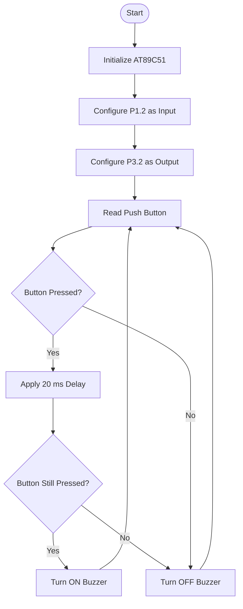

Here is the complete, GitHub-ready `README.md` file with Author, Aim, Apparatus Required, Theory, Circuit Connections, Working Principle, Algorithm, Embedded C Code, Design Calculations, Experimental Readings, Result, Applications, and Conclusion.

Create a file named `README.md` and copy the following content.

Writing

# 🔔 Push-Button-Controlled Buzzer and Speaker Using AT89C51 Microcontroller

## Author Details

- **Author Name:** Your Name
- **Department:** Your Department
- **College:** Your College Name
- **Project:** Push-Button-Controlled Buzzer and Speaker
- **Microcontroller:** AT89C51
- **Programming Language:** Embedded C

---

## 1\. Aim

To design and implement a push-button-controlled buzzer and speaker using the AT89C51 microcontroller. The system detects the input from a push button and activates the buzzer and speaker through a BC547 NPN transistor. The audible indicators remain ON while the button is pressed and turn OFF when the button is released.

## 2\. Apparatus Required

| S.No. | Component | Specification | Quantity |
| --- | --- | --- | --- |
| 1 | Microcontroller | AT89C51 | 1 |
| 2 | Push Button | Normally Open | 2 |
| 3 | Buzzer | 5V DC | 1 |
| 4 | Speaker | Low-power speaker | 1 |
| 5 | NPN Transistor | BC547 | 1 |
| 6 | Base Resistor | 330 Ω | 1 |
| 7 | Pull-down Resistor | 10 kΩ | 1 |
| 8 | Reset Resistor | 10 kΩ | 1 |
| 9 | Capacitor | 0.1 µF | 1 |
| 10 | Crystal Oscillator | 11.0592 MHz | 1 |
| 11 | Power Supply | Regulated +5V DC | 1 |
| 12 | Connecting Wires | — | As required |
| 13 | Computer | Keil µVision IDE | 1 |
| 14 | Digital Multimeter | Voltage measurement | 1 |

## 3\. Software Requirements

- Keil µVision IDE
- Embedded C Compiler
- Proteus Design Suite
- 8051 Microcontroller Programmer

## 4\. Theory

The AT89C51 is an 8-bit microcontroller belonging to the 8051 family. It is widely used in embedded systems for controlling electronic devices and performing automation tasks.

It consists of an 8-bit CPU, 4 KB of Flash program memory, 128 bytes of RAM, 32 programmable input/output pins, two 16-bit timers/counters, a serial communication port, and interrupt control circuitry.

In this project, the AT89C51 microcontroller is used to control a buzzer and speaker based on the input received from a push button.

The push button is connected to Port 1, pin P1.2. A 10 kΩ pull-down resistor is connected between the input pin and ground to maintain a stable LOW logic level when the button is not pressed.

When the push button is pressed, a HIGH logic signal is applied to P1.2. The microcontroller detects this signal and generates a HIGH output at P3.2.

The output signal is applied to the base of a BC547 NPN transistor through a 330 Ω resistor. The transistor acts as an electronic switch and controls the current flowing through the buzzer.

When the transistor switches ON, current flows through the buzzer and produces an audible sound. When the button is released, the transistor switches OFF and the sound stops.

Thus, this project demonstrates digital input interfacing, transistor switching, and output-device control using the AT89C51 microcontroller.

## 5\. Description of Components

### 5.1 AT89C51 Microcontroller

The AT89C51 is an 8-bit microcontroller used in embedded control applications.

**Features:**

- 8-bit CPU.
- 4 KB Flash memory.
- 128 bytes internal RAM.
- 32 programmable I/O pins.
- Two 16-bit timers/counters.
- Serial communication interface.
- Five interrupt sources.

**Applications in this project:**

- P1.2 receives the push-button input.
- P3.2 controls the transistor driver.
- VCC and GND provide the required power supply.

### 5.2 Push Button

A push button is a mechanical switching device used to establish or interrupt an electrical connection.

A normally open push button remains open when released and closes when pressed.

- Released condition: LOW logic.
- Pressed condition: HIGH logic.

### 5.3 Buzzer

A buzzer is an electronic sound-producing device that converts electrical energy into sound energy.

A 5V active buzzer contains an internal oscillator and produces sound when DC power is supplied.

### 5.4 Speaker

A speaker converts electrical audio signals into sound waves through the movement of its diaphragm.

A passive speaker requires an alternating audio signal to produce continuous sound. A suitable audio driver is required for proper speaker operation.

### 5.5 BC547 Transistor

The BC547 is a general-purpose NPN bipolar junction transistor.

It consists of three terminals:

- Base (B)
- Collector (C)
- Emitter (E)

The transistor operates as an electronic switch. When sufficient base current is supplied, it allows current to flow from collector to emitter.

### 5.6 Resistors

Resistors are used to limit current and maintain stable voltage levels.

- 330 Ω resistor: Limits transistor base current.
- 10 kΩ resistor: Maintains LOW input when the push button is released.
- 10 kΩ reset resistor: Forms part of the reset circuit.

### 5.7 Capacitor

A 0.1 µF capacitor is used for supply decoupling or as part of the reset circuit, depending on the circuit arrangement.

## 6\. Circuit Connections

| AT89C51 Pin | Connection |
| --- | --- |
| P1.2 (Pin 3) | Push-button input |
| P3.2 (Pin 12) | BC547 base through 330 Ω |
| VCC (Pin 40) | +5V supply |
| GND (Pin 20) | Ground |
| RST (Pin 9) | Reset circuit |
| XTAL1 (Pin 19) | Crystal oscillator |
| XTAL2 (Pin 18) | Crystal oscillator |

### Input Connections

- One terminal of the push button is connected to +5V.
- The other terminal is connected to P1.2.
- A 10 kΩ pull-down resistor is connected between P1.2 and GND.

### Output Connections

- P3.2 is connected to the BC547 base through a 330 Ω resistor.
- The emitter is connected to ground.
- The collector is connected to the negative terminal of the buzzer.
- The positive terminal of the buzzer is connected to +5V.

**Note:** Use a suitable audio driver for a passive speaker. Check transistor current ratings before connecting multiple loads. Use a flyback diode across a magnetic buzzer where required.

## 7\. Working Principle

The system works on the principle of digital switching and transistor operation.

1. Initially, the push button is in the released condition.
2. The 10 kΩ pull-down resistor maintains P1.2 at LOW logic level.
3. The microcontroller continuously monitors the input pin.
4. When the button is pressed, +5V is applied to P1.2.
5. The input changes from LOW to HIGH.
6. The microcontroller detects the HIGH signal.
7. P3.2 becomes HIGH.
8. Base current flows into the BC547 transistor through the base resistor.
9. The transistor switches ON and activates the buzzer.
10. When the button is released, P1.2 becomes LOW.
11. P3.2 becomes LOW and the transistor switches OFF.
12. The buzzer stops producing sound.

## 8\. Algorithm

1. Start the system.
2. Initialize the AT89C51 microcontroller.
3. Configure P1.2 as input.
4. Configure P3.2 as output.
5. Set the output initially LOW.
6. Read the push-button input.
7. Check whether the button is pressed.
8. If pressed, introduce a 20 ms debounce delay.
9. Verify the input again.
10. If the input remains HIGH, switch ON the buzzer.
11. If the input is LOW, switch OFF the buzzer.
12. Repeat the process continuously.

## 9\. Flowchart

mermaid



## 10\. Embedded C Program

c

```c
#include <reg51.h>

sbit BUTTON = P1^2;
sbit BUZZER = P3^2;

void delay_ms(unsigned int ms)
{
    unsigned int i, j;

    for(i = 0; i < ms; i++)
    {
        for(j = 0; j < 112; j++)
        {
            /* Approximate delay */
        }
    }
}

void main(void)
{
    BUTTON = 1;
    BUZZER = 0;

    while(1)
    {
        if(BUTTON == 1)
        {
            delay_ms(20);

            if(BUTTON == 1)
            {
                BUZZER = 1;
            }
        }
        else
        {
            BUZZER = 0;
        }
    }
}
```

## 11\. Program Explanation

- `#include <reg51.h>` includes the 8051 register definitions.
- `BUTTON = P1^2` assigns P1.2 as the input pin.
- `BUZZER = P3^2` assigns P3.2 as the output pin.
- `delay_ms()` generates an approximate software delay.
- `BUTTON = 1` releases the port pin for input operation.
- `BUZZER = 0` initially switches OFF the output.
- `while(1)` continuously executes the program.
- `if(BUTTON == 1)` checks whether the push button is pressed.
- `delay_ms(20)` reduces false triggering caused by switch bouncing.
- `BUZZER = 1` activates the transistor driver.
- `BUZZER = 0` deactivates the transistor driver.

## 12\. Design Calculations

### 12.1 Power Supply Calculation

Given:

- Supply voltage = 5V
- Assumed microcontroller current = 20 mA

Power consumption:

P = V × I

P = 5 × 0.02

P = 0.1 W

Therefore, the estimated microcontroller power consumption is:

**P = 100 mW**
**output**


### 12.2 Pull-Down Resistor Calculation

Given:

- Supply voltage = 5V
- Pull-down resistance = 10 kΩ

Using Ohm's law:

I = V/R

I = 5/10000

I = 0.0005 A

I = 0.5 mA

Therefore, the pull-down resistor current when the button is pressed is:

**I = 0.5 mA**

### 12.3 Transistor Base Resistor Calculation

Given:

- Output voltage (nominal assumption) = 5V
- Base-emitter voltage = 0.7V
- Base resistor = 330 Ω

Base current:

Ib = (Vout - Vbe)/Rb

Ib = (5 - 0.7)/330

Ib = 4.3/330

Ib = 0.013 A

Ib = 13.03 mA

Therefore, the nominal calculated base current is approximately:

**Ib = 13.03 mA**

The actual base current depends on the AT89C51 output voltage under load. Verify the microcontroller's guaranteed output-current specifications before using this resistor value.

### 12.4 Buzzer Power Calculation

Assume:

- Buzzer voltage = 5V
- Buzzer current = 30 mA

Power:

P = V × I

P = 5 × 0.03

P = 0.15 W

Therefore:

**Buzzer power = 150 mW**

This is an illustrative calculation. Actual current depends on the selected buzzer.

### 12.5 Transistor Collector Current

Assume:

- Collector current = 30 mA
- Base current for illustrative design = 3 mA

Forced current gain:

Beta = Ic/Ib

Beta = 30/3

Beta = 10

Therefore:

**Forced current gain = 10**

The base current and resistor must be selected according to the transistor datasheet and microcontroller output-current limits.

### 12.6 Debouncing Delay Calculation

The software uses a delay of 20 milliseconds to reduce mechanical switch bouncing.

Given:

Delay = 20 ms

Converting into seconds:

20/1000 = 0.02 seconds

Therefore:

**Debouncing delay = 0.02 seconds**

### 12.7 Total Power Calculation

Assume:

- Microcontroller current = 20 mA
- Buzzer current = 30 mA

Total current:

Itotal = 20 + 30

Itotal = 50 mA

Total power:

Ptotal = V × I

Ptotal = 5 × 0.05

Ptotal = 0.25 W

Therefore:

**Estimated total power = 250 mW**

These are theoretical example values, not measured experimental readings.

## 13\. Experimental Procedure

1. Connect the AT89C51 to a regulated +5V power supply.
2. Connect the crystal oscillator to XTAL1 and XTAL2.
3. Connect the reset circuit to the RST pin.
4. Connect the push button to P1.2.
5. Connect the 10 kΩ pull-down resistor between P1.2 and ground.
6. Connect P3.2 to the BC547 base through the selected resistor.
7. Connect the buzzer driver circuit.
8. Write the Embedded C program in Keil µVision.
9. Compile the program and generate the HEX file.
10. Load the HEX file into the AT89C51 or Proteus simulation.
11. Switch ON the power supply.
12. Press the push button and observe the buzzer operation.
13. Release the button and verify that the buzzer switches OFF.
14. Record the voltage readings using a digital multimeter.

## 14\. Experimental Readings / Observation Table

The following table contains expected illustrative readings. Actual laboratory readings should be recorded during hardware testing.

| S.No. | Button Condition | P1.2 Voltage | Input Logic | P3.2 Output | Buzzer |
| --- | --- | --- | --- | --- | --- |
| 1 | Released | 0V | LOW | LOW | OFF |
| 2 | Pressed | 5V | HIGH | HIGH | ON |
| 3 | Released | 0V | LOW | LOW | OFF |
| 4 | Pressed | 5V | HIGH | HIGH | ON |
| 5 | Pressed continuously | 5V | HIGH | HIGH | ON |
| 6 | Released | 0V | LOW | LOW | OFF |

### Voltage Measurement Table

| Measurement Point | Expected Voltage |
| --- | --- |
| VCC (Pin 40) | +5V |
| GND (Pin 20) | 0V |
| P1.2 when released | Approximately 0V |
| P1.2 when pressed | Approximately 5V |
| P3.2 when released | Approximately 0V |
| P3.2 when pressed | HIGH logic voltage |
| BC547 emitter | 0V |
| Buzzer positive terminal | +5V |
| Buzzer negative terminal when OFF | Approximately +5V |
| Buzzer negative terminal when ON | Approximately 0.1–0.3V |

Actual voltages depend on component specifications and operating conditions.

## 15\. Expected Output

| Push Button Status | P1.2 Input | P3.2 Output | Buzzer | Speaker |
| --- | --- | --- | --- | --- |
| Released | LOW | LOW | OFF | OFF |
| Pressed | HIGH | HIGH | ON | ON\* |

_Speaker operation requires a suitable audio-frequency driver when using a passive speaker._

## 16\. Result Analysis

The experimental operation demonstrates that the AT89C51 can detect digital input signals and control external devices through its output pins.

When the push button is pressed, P1.2 receives a HIGH logic signal. The microcontroller generates a HIGH output at P3.2, activating the BC547 transistor driver.

When the push button is released, P1.2 becomes LOW, and the transistor switches OFF.

Thus, the system demonstrates successful digital input interfacing and transistor-based output switching.

## 17\. Advantages

- Simple and low-cost circuit design.
- Easy to implement and understand.
- Requires fewer external components.
- Provides immediate audible alerts.
- Demonstrates digital input/output interfacing.
- Can be expanded for multiple warning conditions.

## 18\. Applications

- Security alarm systems.
- Emergency warning systems.
- Doorbell circuits.
- Industrial fault indicators.
- Vehicle warning systems.
- Patient assistance systems.
- Home automation systems.
- Electronic notification systems.

## 19\. Limitations

- The basic circuit supports ON/OFF sound control.
- Different sound frequencies are not generated by the given program.
- Mechanical switch bouncing may cause unstable readings.
- A passive speaker requires an audio-frequency driver.
- Output current is limited by the transistor and microcontroller specifications.

## 20\. Future Enhancements

- Add multiple push buttons for different alarm conditions.
- Generate different tones using timer interrupts.
- Add LED indicators.
- Implement adjustable alarm duration.
- Add an LCD display to show system status.
- Develop a password-based security alarm system.
- Add an audio amplifier for the speaker.

## 21\. Conclusion

The push-button-controlled buzzer and speaker system was designed using the AT89C51 microcontroller and Embedded C programming.

The microcontroller detects the push-button input and controls the audible output through a BC547 transistor driver.

When the push button is pressed, the buzzer is activated. When the button is released, the buzzer is switched OFF.

The project demonstrates the fundamental concepts of digital input interfacing, transistor switching, and embedded system control.

Therefore, the design and implementation of a push-button-controlled buzzer and speaker using the AT89C51 microcontroller were successfully studied and demonstrated.

## 22\. References

1. AT89C51 Microcontroller Datasheet – Microchip Technology.
2. BC547 NPN Transistor Datasheet.
3. 8051 Microcontroller Architecture and Interfacing.
4. Keil µVision Embedded C Compiler Documentation.
5. Electronic Devices and Circuit Theory – Robert L. Boylestad.

---

## Project Summary

| Parameter | Description |
| --- | --- |
| Project Title | Push-Button-Controlled Buzzer and Speaker |
| Controller | AT89C51 |
| Programming Language | Embedded C |
| Input Device | Push Button |
| Output Devices | Buzzer and Speaker |
| Switching Device | BC547 NPN Transistor |
| Operating Voltage | +5V DC |
| Software | Keil µVision |
| Simulation | Proteus |


